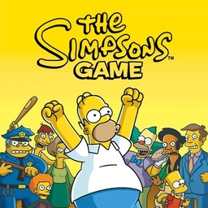

<h1 align=center>The Simpsons Game — Nintendo Switch port</h1>

<p align="center"></p>

A native Nintendo Switch port of the Xbox 360 version of **The Simpsons Game** (2007).

It's not an emulator. The PowerPC code of the game's `default.xex` is statically recompiled to C++ with
[ReXGlue](https://github.com/rexglue/rexglue-sdk) and compiled for the Switch, and the game is drawn by a native
Vulkan renderer running on NVK (Mesa). It targets **a locked 30 FPS**.

the-simpsons-game-nx is built from [TheSimpsonsGameRecomp](https://github.com/YesterMester/TheSimpsonsGameRecomp),
the recompilation of the game for PC, and takes its Switch layer and native renderer from
[project8-sw](https://github.com/R-drg/project8-sw), the Switch port of Tony Hawk's Project 8, whose renderer adapts
the one in [nfsmw-nx](https://github.com/StevensND/nfsmw-nx) by StevensND. See [Credits](#credits).

> [!NOTE]
> You need your own copy of the Xbox 360 game: a disc image (`.iso`) or the extracted disc with its `default.xex`.
> Supported: the USA retail disc (`default.xex` SHA-256 `71d99dad…a82a231`, title ID `45410809`). The program is
> compiled from that exact executable, so other releases do not run.

## How to install

1. Open the installer page: **https://r-drg.github.io/the-simpsons-game-nx-installer/**
2. Choose your format (**Disc image (.iso)** or **Game folder**, the folder with `default.xex` and the disc's
   folders) and press **Create the-simpsons-game-nx.zip**. Everything runs in your browser and the game files never
   leave your computer: the page checks your copy, downloads the build and puts the two together.
3. Extract the downloaded zip into `sdmc:/switch/`.

Your folder should look like this:

```text
/switch/the_simpsons_game/
  the_simpsons_game.nro
  simpsons.toml             (settings)
  LICENSES.txt              (licences of the software in the NRO)
  game/                     (the files of your disc: default.xex, audiostreams, frontend, movies, ...)
```

The game creates `simpsons/` (saves and caches) and `logs/` next to the NRO the first time it runs.

Launch it in title takeover mode: hold **R** while starting any installed game to open the Homebrew Menu, then start
**The Simpsons Game**. A forwarder should also work if you set it to a **39-bit address space**. Applet mode (from
the Album) gives homebrew much less memory and is not supported.

> [!IMPORTANT]
> **Clocks.** The port was tested with sys-clk at **CPU 1785 MHz and GPU 768 MHz** in handheld mode, and that is
> what 30 FPS needs. At stock handheld clocks (CPU 1020, GPU 307) the game drops to about 19 FPS, and cutscenes fall
> behind their audio, which keeps playing in real time.

> [!NOTE]
> **Updating:** open the installer page again and press **Create the-simpsons-game-nx-update.zip**. It only contains
> the NRO, `simpsons.toml` and `LICENSES.txt`, so there is no need to copy the game files again: extract it over your
> existing folder. It replaces `simpsons.toml`; note any setting you changed first.

## Controls

Each Switch button acts as the Xbox 360 button with the same letter, so the letter in the on-screen prompts is the
button to press.

<div align="center">

| Switch | Xbox 360 |
| --- | --- |
| A / B / X / Y | A / B / X / Y |
| ZR / ZL | RT / LT |
| R / L | RB / LB |
| + | Start |
| − | Back |
| Sticks / D-pad | Sticks / D-pad |

</div>

To use the face buttons by position instead, as on an Xbox pad (B acts as A, A as B, Y as X and X as Y), add
`input_xbox_layout = true` to `simpsons.toml`.

## Performance

Tested on a Switch in handheld mode at CPU 1785 MHz and GPU 768 MHz (set by sys-clk). Menus, cutscenes and normal
play hold a locked 30 FPS. Scenes with many particles at once (Homer's burp, blowing things up) can drop briefly to
26–28 FPS: at that point the limit is the game's own CPU threads, not the renderer. Docked mode and stock clocks
were not measured for this release.

The port caps the game at 30 FPS and spaces the frames evenly (`gameplay_frame_rate`, `menu_frame_rate`,
`nx_min_frame_vblanks` in `simpsons.toml`).

## Known issues

- A short hitch can happen the first time a new effect appears, while its pipeline is compiled.
- Heavy particle scenes can dip to 26–28 FPS.
- At clocks below the tested ones, cutscene audio runs ahead of the picture.

More detail is in [docs/known-issues.md](docs/known-issues.md).

## How it works

- **The game's code is translated, not emulated.** ReXGlue translates every function of `default.xex` to C++, which
  is then compiled for the Switch, and gives the game what it expects from an Xbox 360: its system, files, audio and
  controllers. The Horizon (Switch) layer of the SDK, adapted from project8-sw, is in `patches/rexglue-sdk/`.
- **Its own renderer.** The port reads the commands the game sends to the GPU and draws the same frame with Vulkan:
  render targets are plain images, resolves are image copies, shaders are translated once and cached, textures are
  untiled on worker threads. Vertex data is copied only for the range each draw reads, worked out from the index
  range and the vertex shader. The game's four costliest full-screen effects use the PC port's hand-written
  replacement shaders (`tools/native-renderer/native_shaders/`), compiled into the NRO.
- **Its own graphics driver.** Vulkan runs on NVK, from the Mesa project, through
  [mesa-switch](https://github.com/danfromtico/mesa-switch), with project8-sw's changes in `patches/mesa-switch/`.

## Build

devkitA64 and libnx from [devkitPro](https://devkitpro.org), CMake, Ninja, Docker, TheSimpsonsGameRecomp (for its
ReXGlue SDK) with `patches/rexglue-sdk/`, the Vulkan driver built from mesa-switch with `patches/mesa-switch/`, and
your own copy of the game for the code generator. The whole process is in [docs/building.md](docs/building.md).

<div align="center">

| Folder | Contents |
| --- | --- |
| `src/game/` | The game: hooks, frame pacing, native renderer (`src/native/`), Switch entry point, CMake project, code generator configuration |
| `patches/rexglue-sdk/` | The SDK changes: Horizon runtime, memory, input, audio, crash handling, GPU, in apply order (`series`) |
| `patches/mesa-switch/` | The graphics driver changes and its build script |
| `release/` | The settings file that goes into the package |
| `tools/` | Toolchain files, the replacement shaders, the notice generator and the release check |
| `docs/` | Documentation |

</div>

## Credits

- **Electronic Arts and EA Redwood Shores** — creators of The Simpsons Game. This is an unofficial, fan-made port
  with no affiliation.
- **[TheSimpsonsGameRecomp](https://github.com/YesterMester/TheSimpsonsGameRecomp)** and its contributors — the
  recompilation project this port is built from: the code generator configuration, the game's hooks, frame pacing
  and the replacement shaders.
- **[project8-sw](https://github.com/R-drg/project8-sw)** — the Switch runtime, the native renderer and the driver
  patches this port reuses.
- **[StevensND](https://github.com/StevensND)** — [nfsmw-nx](https://github.com/StevensND/nfsmw-nx), whose native
  renderer `src/game/src/native/` adapts (GPL-3.0) and whose Mesa changes `patches/mesa-switch/0002` takes (MIT);
  and [nfsmw-nx-installer](https://github.com/StevensND/nfsmw-nx-installer), which the installer page is adapted
  from.
- **[Tom Clay](https://github.com/rexglue/rexglue-sdk)** — the ReXGlue SDK, built on the work of the
  **[Xenia](https://xenia.jp)** team.
- **[danfromtico](https://github.com/danfromtico/mesa-switch)** and **[NaGaa95](https://github.com/NaGaa95/mesa-switch)**
  — mesa-switch: Mesa, NVK and NAK on Horizon. And the **[Mesa](https://mesa3d.org)** developers.
- **[devkitPro](https://devkitpro.org) and [switchbrew](https://github.com/switchbrew/libnx)** — devkitA64 and libnx.
- The other libraries listed in [THIRD_PARTY_NOTICES.md](THIRD_PARTY_NOTICES.md), with their licence texts in
  [NOTICE](NOTICE).

Switch port by Rodrigo Ferreira.

## Legal

No affiliation with Electronic Arts, 20th Television or Gracie Films. The Simpsons Game and its marks belong to
their respective owners. This repository contains no assets and no program code from the original game: the
translated code is generated from your own `default.xex` when you build. The released NRO is that translation
compiled for the Switch; it holds no game assets and not the original executable, and it needs your own copy of the
supported disc next to it, which the installer page puts there on your own computer. Users must provide their own
legally obtained copy. The NRO's icon is the game's cover art (`src/game/switch/icon.jpg`), used only to identify
the game in the Homebrew Menu. Running homebrew requires custom firmware, which violates Nintendo's terms of service
and can get a console banned — your call.

Source code is provided under the GNU General Public License, version 3 (see [LICENSE](LICENSE)), the licence of
TheSimpsonsGameRecomp and of the nfsmw-nx code it adapts. The driver changes in `patches/mesa-switch/` are under
Mesa's MIT licence.
